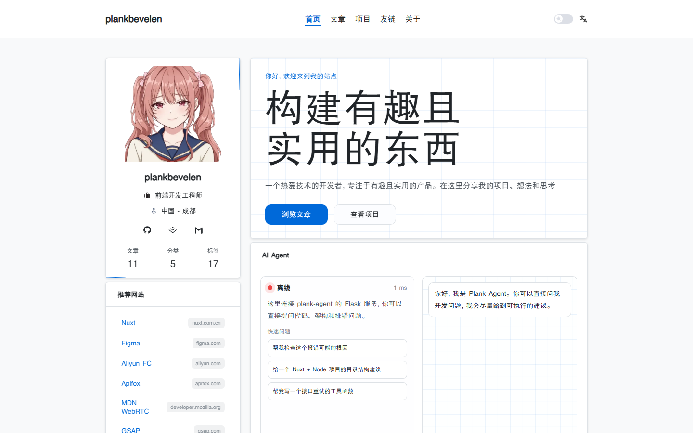

# plankbevelen

[plankbevelen](https://plankbevelen.cn) 的个人技术博客。前台用 Nuxt 做服务端渲染，后台管理文章、分类、友链和站点配置，数据存在 MongoDB。

[](https://plankbevelen.cn)

## 功能

- 首页、文章列表与详情、分类、标签和站内搜索
- 关于、时间线、项目、友链、隐私政策
- 中英文界面，默认中文；英文页面走 `/en` 前缀
- 后台：登录、文章编辑（Markdown）、分类、统计、站点内容、友链审核、访问日志
- 站点地图与 `robots.txt`，后台路径不进入收录
- 可选：Redis、Cloudflare Turnstile、本地助手服务

## 技术栈

- [Nuxt 4](https://nuxt.com) / Vue 3 / Nitro
- Pinia、Vue I18n、Tailwind CSS、Element Plus
- MongoDB
- Redis（可选，验证码和限流；未配置时使用进程内内存）

## 环境要求

- Node.js 20+
- pnpm 9+
- 本机或远程可访问的 MongoDB

## 本地开发

```bash
pnpm install
```

在项目根目录新建 `.env`（该文件已被 git 忽略，不会进仓库）：

```bash
NUXT_MONGO_URI=mongodb://127.0.0.1:27017
NUXT_MONGO_DB=plankbevelen-blog

NUXT_AUTH_SECRET=至少32位的随机字符串
NUXT_ADMIN_ACCOUNT=admin
NUXT_ADMIN_PASSWORD=$argon2id$...
```

`NUXT_ADMIN_PASSWORD` 填密码哈希，不填明文。安装依赖后可以这样生成 Argon2id 哈希和登录密钥：

```bash
node --input-type=module -e "import { hash } from '@node-rs/argon2'; console.log(await hash('换成你的密码'))"
node --input-type=module -e "import { randomBytes } from 'node:crypto'; console.log(randomBytes(32).toString('hex'))"
```

也兼容历史的 SHA-256 十六进制哈希。以 `$argon2` 开头时按 Argon2 校验，否则按 SHA-256 校验。

```bash
pnpm dev
```

开发服务默认在 `http://127.0.0.1:3000`。后台入口是 `/admin/login`。

管理员账号、登录密钥和大部分运行参数只在数据库里还没有 `runtime-settings` 时，从 `.env` 写入一次。之后到后台「站点设置」里改。已经写入的账号和密码，再改 `.env` 不会覆盖数据库。

## 环境变量

| 变量 | 说明 |
| --- | --- |
| `NUXT_MONGO_URI` | MongoDB 连接串，默认 `mongodb://127.0.0.1:27017` |
| `NUXT_MONGO_DB` | 数据库名，默认 `plankbevelen-blog` |
| `NUXT_AUTH_SECRET` | 会话签名密钥 |
| `NUXT_ADMIN_ACCOUNT` | 首次种子管理员账号 |
| `NUXT_ADMIN_PASSWORD` | 首次种子密码哈希（Argon2id 或 SHA-256 hex） |
| `REDIS_URL` | 可选。验证码、限流等短时数据 |
| `NUXT_TURNSTILE_SITE_KEY` / `NUXT_TURNSTILE_SECRET_KEY` | 可选。Cloudflare Turnstile |
| `NUXT_PUBLIC_AGENT_CHAT_URL` / `NUXT_PUBLIC_AGENT_HEALTH_URL` | 可选。本地助手服务，默认 `127.0.0.1:6543` |
| `TRUST_PROXY` | 设为 `1` 时信任反向代理转发的客户端 IP |
| `COOKIE_SECURE` | `1` 强制 Secure Cookie，`0` 关闭；生产环境默认开启 |
| `UPLOAD_DIR` | 生产环境上传目录，默认 `/var/www/uploads` |
| `UPLOAD_MAX_BYTES` | 单文件大小上限，默认 5MB |

## 脚本

| 命令 | 作用 |
| --- | --- |
| `pnpm dev` | 开发服务 |
| `pnpm dev:local` | 使用 `.env.development`，监听 `127.0.0.1:3000` |
| `pnpm build` | 生产构建 |
| `pnpm preview` | 本地预览生产构建 |
| `pnpm start` | 运行 `.output/server/index.mjs` |
| `pnpm security:test` | 安全自测。先用 `SECURITY_TEST_HOOK=1 pnpm dev` 启动，再执行本命令 |

## 目录

```text
app/        前台与后台页面、组件
server/     API、鉴权、MongoDB
i18n/       中英文文案
public/     静态资源
.github/    推送到 main 后的生产部署
```

## 部署

生产环境是 Nuxt SSR，由 PM2 按 `ecosystem.prod.config.cjs` 拉起，监听 `3000` 端口。

推送到 `main`，或在 GitHub Actions 里手动触发 **Deploy production**，会通过 SSH 在服务器上拉代码、安装依赖、构建并重载 PM2。工作流需要这些仓库 Secrets：

- `SSH_HOST`
- `SSH_PORT`
- `SSH_USER`
- `SSH_KEY`

服务器上单独放置 `.env`，不要提交到仓库。当前部署目录是 `/var/www/plankbevelen-blog`。
